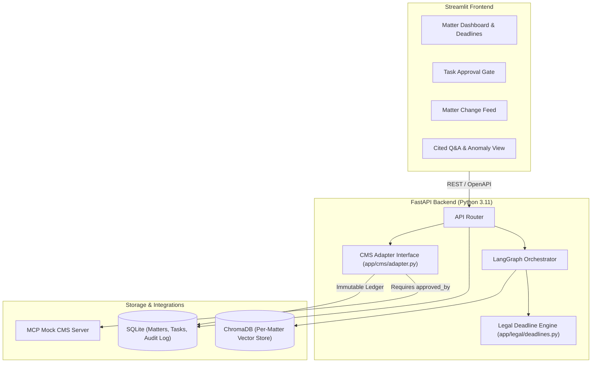

# CasePilot (PS-01: Streamlining Case Management)

> An AI orchestration layer that automates case management tasks — docketing, filing, deadline tracking, status updates — inside the case management systems law firms already use.

---

## 🎯 Problem Statement (PS-01)
Law firms lose thousands of billable hours to administrative friction: tracking statutory deadlines across disparate jurisdictions, routing court filings into matter folders, updating case management systems (CMS), and detecting critical conflicts across voluminous evidence. 

**CasePilot** bridges legacy CMS infrastructure and AI intelligence by providing an orchestration layer that extracts actionable deadlines, automates matter organization, flags evidence contradictions, and safely writes tasks back to the CMS behind an **attorney approval gate**.

---

## 🏗️ Architecture



---

## 🚀 Quickstart

### Prerequisites
- Docker & Docker Compose **OR** Python 3.11+ with `pip`

### One-Command Launch (Docker Compose)
```bash
docker compose up --build
```
- **Streamlit UI**: [http://localhost:8501](http://localhost:8501)
- **FastAPI Backend & Docs**: [http://localhost:8000/docs](http://localhost:8000/docs)

### Local Development Setup
```bash
# 1. Create and activate virtual environment
python3.11 -m venv venv
source venv/bin/activate

# 2. Install dependencies
pip install -r requirements.txt

# 3. Run test suite
pytest

# 4. Start backend
uvicorn app.main:app --reload --port 8000 &

# 5. Start Streamlit frontend
streamlit run ui/app.py --server.port 8501
```

---

## 🎬 Demo Walkthrough Script

Follow the PS-01 verification storyboard (`.agent/workflows/demo.md`):

1. **Matter Dashboard**: Open [http://localhost:8501](http://localhost:8501) to view active matters, pending deadlines, and overdue alerts.
2. **Ingest & Classify**: Upload a synthetic court pleading (e.g. `fixtures/summons_and_complaint.txt`) to trigger auto-classification and matter folder suggestion.
3. **Deadline Extraction & Approval**: Review proposed statutory deadlines. Verify that CMS write-back requires explicit attorney authorization (`approved_by`).
4. **Change Feed**: Review matter change ledger summarizing recent filings, new calendar tasks, and notifications.
5. **Cited Case-File Q&A**: Ask substantive questions and inspect structured source citations `{doc_id, chunk_id, page}`.
6. **Contradiction Flag**: Ingest conflicting deposition transcripts to observe automatic discrepancy detection with dual citation comparison.

---

## 🛡️ Guardrails & Non-Negotiables

- **Synthetic Data Only**: All demo fixtures contain strictly synthetic names, dates, and docket numbers. No real client data or PII.
- **Human-in-the-Loop Approval Gate**: No write to the CMS adapter occurs without an `approved_by` attorney signature.
- **Strict Citation Requirement**: Every AI-generated answer or recommendation is bound to `{doc_id, chunk_id, page}`.
- **Deterministic Legal Rules**: Statutory deadline math is never hallucinated; all calendar logic is executed by verified unit-tested algorithms in `app/legal/deadlines.py`.
- **Auditability**: All actions, approvals, and adapter writes produce immutable audit logs.
